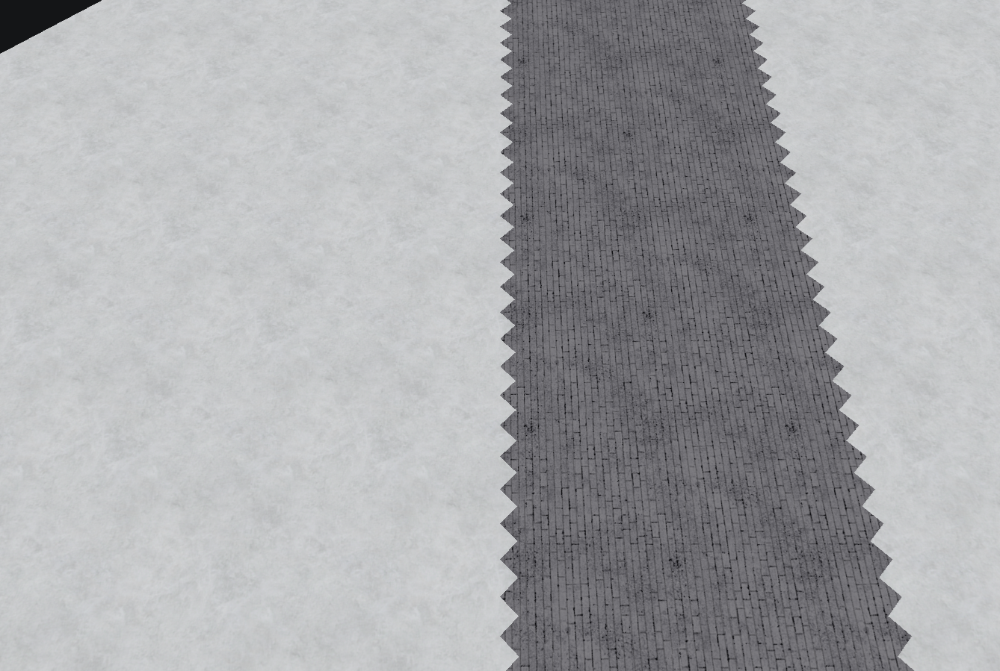
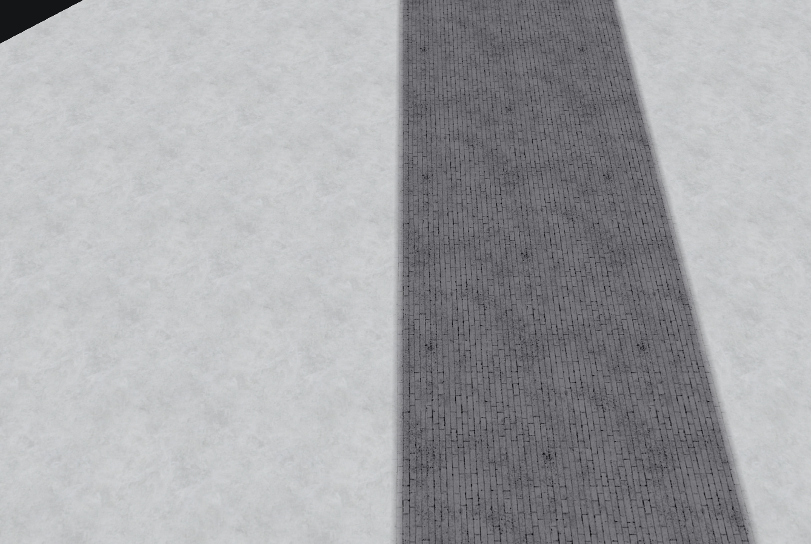
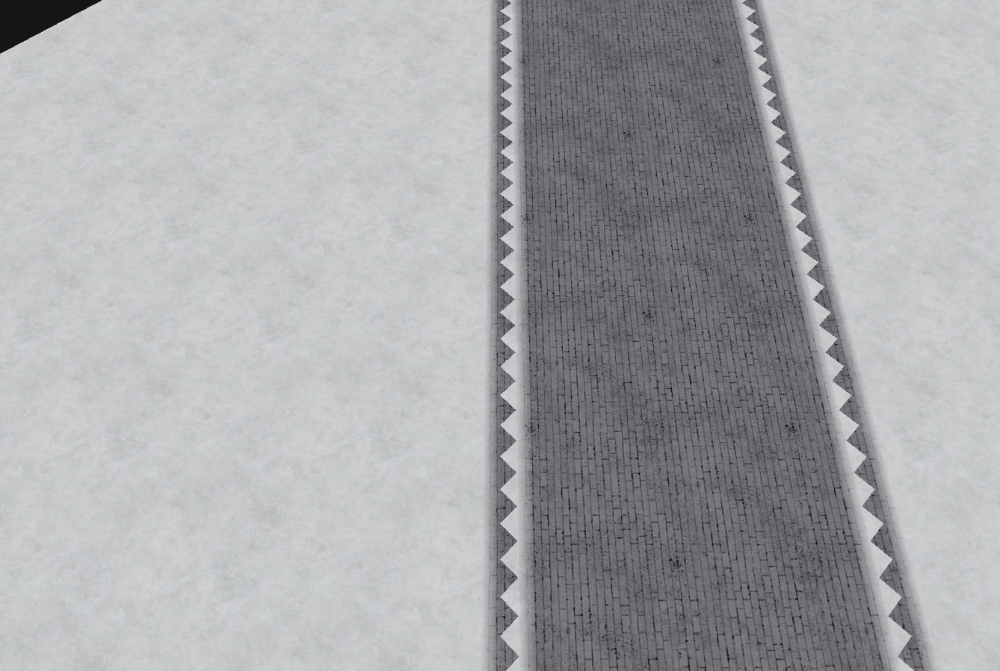
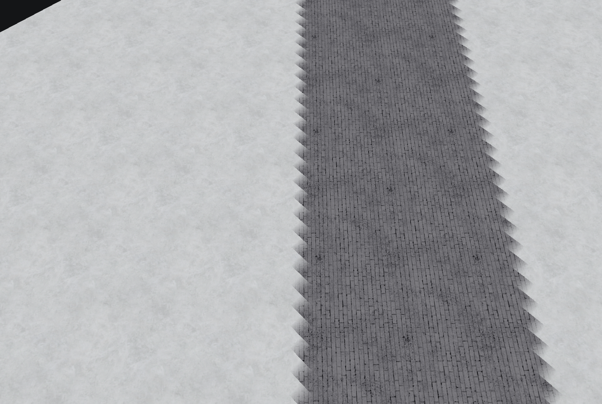

# 45°地表交界：实测样板与可靠操作

适用于城市铺装/雪地、铁路道床/雪地等高对比斜向交界。下列结论来自隔离平地样板、逐格混合记录、同机位地编截图与官方成熟边界的局部数据；不是“执行成功所以好看”的推断。此页没有修改地编源码，也没有修改斯大林格勒 R2。

## 已验证结果

样板可玩范围 64×64、border=4、平地高度 250。用 `Snow_Solvang01` 作底、`Pavement_Kremlin02` 作斜向条带；条带的数组格条件为 `58 ≤ x+y ≤ 78`，这组数只用于复现实验，不是制图规格。六张地图具有同一底纹形状，只有边缘处理方法不同。每张地图保存后关闭重开，逐格底纹、两层引用和方向表一致。

| 方法 | 混合影响格数 | 内部相邻边不连续数 | 实际画面结论 |
|---|---:|---:|---|
| 只刷底纹，未细化 | 0 | 202 | 高对比斜边出现重复三角齿 |
| 只从铺装连通区做一次 Auto Edge Out | 242 | **0** | 两侧过渡连续，重复齿消失 |
| 从两片雪地分别做 Auto Edge Out | 246 | **0** | 过渡连续，但保留/扩散方向与上一种不同 |
| 只从铺装连通区做 Auto Edge In | 242 | **0** | 在这条平直条带上与 Out 完全相同；不能推广到复杂凹角 |
| 对所有材质执行 Auto Edge Out All | 472 | 202 | 两边有混合但三角齿重新出现，不适合作为此边界的完成步骤 |
| 逐格选最近正交来源做 Blend Edge | 118 | 200 | 齿被羽化，轮廓仍呈重复三角，不能代替整条斜边的处理 |

“不连续数”以真实 Core 的角权重和插值，检查样板内部 7,442 条共享边、每边五个位置。它只衡量这组平地/两材质的接缝一致性，不证明所有地形、三材质交点或游戏内显示。画面另行实际检查；未进行原版游戏/原版地编逐像素对照。

后续斯大林格勒用户实测出现新地编平滑、物版 WB/游戏整格硬切，说明本页样板的预览结论不能代替原生验收。UI 与 MCP 同用边缘生成底座；已补新生成记录的 RA3 尾标记和显式旧零标记修复。受控原生Save A/B中，零尾A的11731有效引用全部变占位/清除，纯尾修复B的同11731引用逐格语义保留，确认本次物版路径对原格式不保留；游戏效果仍须单独验证。操作和保存后重编号比较见 [格式与原生差异](terrain-materials-and-edges.md#新地编平滑目标-wb游戏仍硬切时) 和 [兼容验收](game-compatibility.md)。本页既有实验数据与图册保留。

### 同机位画面

下面都是实际地编渲染，使用同一近景相机、原生资源、关闭泛光的新图默认环境。不是游戏截图，也没有用额外家具遮挡边缘。

| 未处理 | 单一来源 Auto Edge Out |
|---|---|
|  |  |

| 所有材质双向处理 | 逐格最近邻单边 |
|---|---|
|  |  |

## 为什么单向连续，双向产生齿

混合不仅有“透明度”，还包括方向和长/短对角。自动边缘遇到两个正交邻格同属来源时，写入 `longDiagonal=true`；逐格 Blend Edge 总是使用短对角/单边逻辑。不能把同一条 45°边界拆成“每格最近一个邻居”就认为等价。

在批量处理的明确失败例中，两个相邻格把同一条接触界线朝相反方向覆盖：

- `(29,28)` 是雪底、混入铺装，flags=`[0,0,1,0,0,1]`。右边中点的铺装权重为 **1**。
- `(30,28)` 是铺装底、混入雪，flags=`[0,0,0,1,1,1]`。左边同一空间点的铺装权重为 **0**。

这两个点是同一条共享边上的同一点；颜色权重却从完全铺装跳到完全雪地。只有铺装来源的 Auto Edge Out 时，两侧该点都为铺装权重 1。仅雪地来源时，两侧都为 0。各自连续，双向叠上后不连续。

这证明当前 `AutoEdgeOutAll` 的“按类号依次给所有异类生成混合”在此布局上会生成相互冲突的接触带；“类号排序可复现”并不等于过渡正确。修复批量工具时应先为一条材质接触界线确定单一来源/优先关系，再处理；不能把一个类的语义从源码注释推定为 EA 画面已验证。Skill 使用者无需为此修改源码，先用下列经过样板验证的局部流程。

## 制图时如何做

1. **先明确硬边还是软边。** 马路路沿、平台边缘、墙基和站台可以保留清晰边饰；草/土、脏雪/净雪、地表铺装与雪通常需要合适的过渡。边饰和真实混合各自检查，不能靠边饰遮住严重齿纹。
2. **先画连续区域，避免逐格来回换纹理。** 地形层级和道路先确定。地表按用途画主面、辅面，再处理交界，不在每栋建筑下面画互不相连的小印章。
3. **一条接触界线选一个来源。** 想让铺装保持较饱满，就从铺装内部选种子向外混；想让雪覆盖铺装边缘，就从雪地选种子。先在一小段试验，实际看过渡位置，再决定整段。不要对同一界线立刻反向重复处理。
4. **使用局部范围。** `radius` 是种子附近的搜索范围，不是混合宽度。小段先用有限 radius；0 会处理整个连通区，须确认该连通区确实都需要改。返回的格数说明范围，不说明视觉质量。
5. **复杂交点拆开设计。** 两层混合容量有限；先确定哪种材质延续、哪种收尾，让第三种与主面有明确小区域，避免在同一格不断叠加来源。小凹角、三材质交点与台阶坡脚须单独看图；本次平直样板没有认证它们。
6. **保存重开并同机位复查。** 检查俯视、游戏常用角度和近景；边线连续、没有重复三角齿、相邻已画材质没有消失才算该段通过。单次工具成功或混合记录非零不能作为验收。

当前接口的操作示意：

```json
{"tool":"ra3map_auto_edge_out","arguments":{"handle":"<当前已验证会话>","cx":34,"cy":34,"radius":20}}
```

该坐标是本实验铺装内的种子示意。实际地图先读取 `ra3map_get_terrain_cells`，确认来源材质与需要修改的范围；数组格坐标包含 border，不能直接拿物体世界坐标填 cx/cy。

## 修复旧边界时的限制

已有区域若混入了两侧相反来源，继续添加一条单边通常不能删除原有错误引用。先另存工作副本，记录底纹与成熟混合，确定最小重绘范围；只重做错误接触带，再用单一来源细化。不要清空整图混合，也不向成熟边界无条件执行全区自动处理。

`ra3map_apply_terrain_patch` 的纹理补丁**不会自动清除既有混合层**，高度补丁也不应该处理材质。恢复了底纹名字不表示冲突混合已经去掉。确需重绘时使用实际绘制命令并读回两层引用，核对改动范围；不能用平滑地形“修复贴图”，更不能把 16,000 次最近邻单边调用当作正确边缘算法。

## 官方成熟记录的对照

对原版克里姆林宫战役来源样例 m050 的数组格 `[310..365]×[350..405]` 做 step=1 只读查询，源文件 SHA256 前后保持不变。该区域的 `Pavement_Kremlin03 → Snow_Solvang09` 第一层有 92 格，反向 `Snow_Solvang09 → Pavement_Kremlin03` 为 0 格。

其中 `(338,380)` 的铺装底混入雪，flags=`[0,0,1,0,0,1]`；邻近 `(337,380)` 与 `(338,379)` 使用同方向短对角，`(339,380)` 与 `(338,381)` 为纯雪地。这与自动边缘依据邻接关系组合长/短对角、只沿一种来源建立接触带的模式相符。此统计是这一个局部的证据，不是“所有官方边界永远单向”的全局规则。样例其他地表有 Transition 纹理与三材质细节，不能把它们简化成全图只有雪和铺装。

可复核记录和实验地图由本次学习工作区保存。Skill 只包含四张必要对照图及结论，不打包原版地图文件、原始着色器或作者电脑路径。
